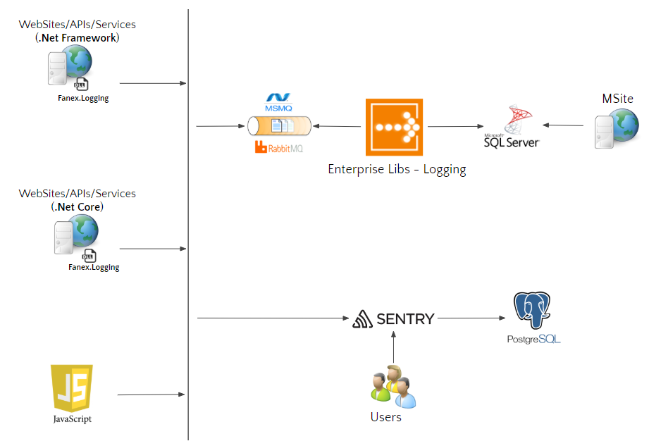

.. fanex.logging documentation master file, created by
   sphinx-quickstart on Wed Nov 21 10:55:03 2018.
   You can adapt this file completely to your liking, but it should at least
   contain the root `toctree` directive.

Introduction
=========================================

Fanex Logging, is a logging library, is one of library in Fanex Library universe.

- It provides standard way for web application and service to log their information.
- It enables decoupling of logging functionality from application code. 
- It can route log entries synchronously or async to a variety of log engines.

Reasons behind the change
=========================================

Due to some drawbacks, Fanex Logging need to be revised to resolve these:

- Fanex Logging sticks tight coupling with *Logging Application Block (one of Microsoft Enterprise Library)*, so there is no way to use other logging engines.
- Enterprise Library is *no longer maintained* by Microsoft
- Fanex Logging cannot support *.net core*, so there is no way to use it in *.net core* project.
- Fanex Logging does not support async method.

High level architect
=========================================

Integration
=========================================

**Step 1. Setup LogManager**

This code you must put in your application startup.

.. code:: csharp

       LogManager
        .SetDefaultLogCategory("{Your-Site-Category}")
        .Use(new List<ILogEngine>
        {
            new RabbitMQLogging("{RabbitMQ-ConnectionString}"),
            new SentryLogging("{Sentry-Option}")
        });

**Notes:** 

- You can use *single or multiple logging engines*, Fanex Logging supports 2 types of Logging Engine, each type has different delivery mechanism. You can implement your own log engine also.
- {Your-Site-Category} is same with property "defaultCategory" in Fanex Logging version 1.0

To use supported log engines, please refer below information:

.. toctree::
   :maxdepth: 2
   
   Entlibs using RabbitMQ <integration-guidelines/rabbitmq> 
   Sentry <integration-guidelines/sentry>

**Step 2.a. To log information in your back-end code, Fanex Logging provides you two ways:**

- First way, you can use these static methods in class *LogService* directly, it's not recommend because it's not easy for unit-test 

.. code:: csharp

        LogService.Error(logMessage);
        LogService.Warn(logMessage);
        LogService.Debug(logMessage);
        LogService.Critical(logMessage);
        LogService.Info(logMessage);

        LogService.ErrorAsync(logMessage);
        LogService.WarnAsync(logMessage);
        LogService.DebugAsync(logMessage);
        LogService.CriticalAsync(logMessage);
        LogService.InfoAsync(logMessage);

- Second way, you can use by create new instance of **Logger** class, this way is easy for you to do dependency injection and unit-test, and I strongly recommend you use this way.

**Step 2.b. To log information in your front-end code, you can add this code in your *.cshtml file:**

.. code:: csharp

        @Html.Raw(Fanex.Logging.LogManager.RenderJavascriptLogger())

Fannex Logging will auto generate script and listen global exception and log information for you

Application Logging Extensions
=========================================

In order to log useful information, Fanex Logging provides some extensions that will help you collect enough information when error occurs for further tracing:

.. toctree::
   :maxdepth: 2
   
   Website/WebAPI Application  <integration-guidelines/web> 
   Service <integration-guidelines/service> 

   