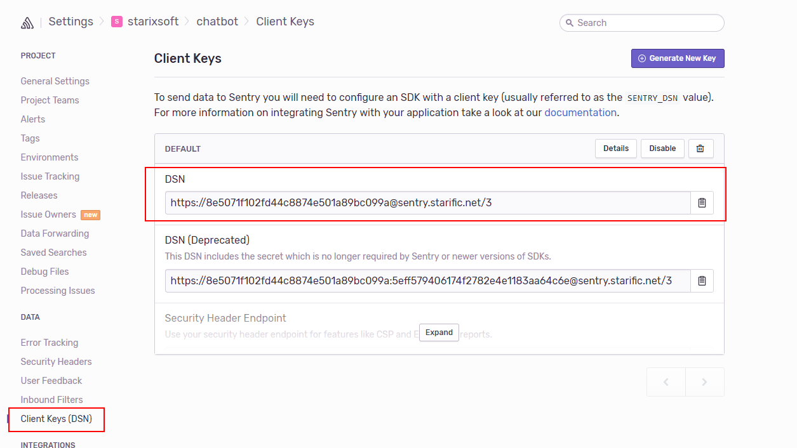
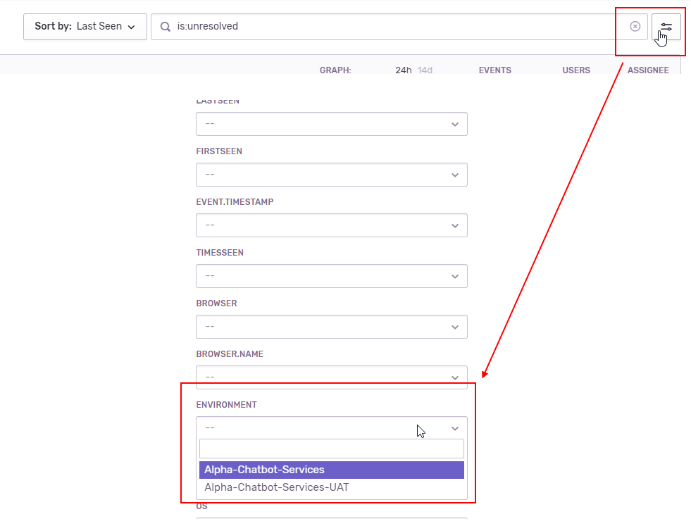
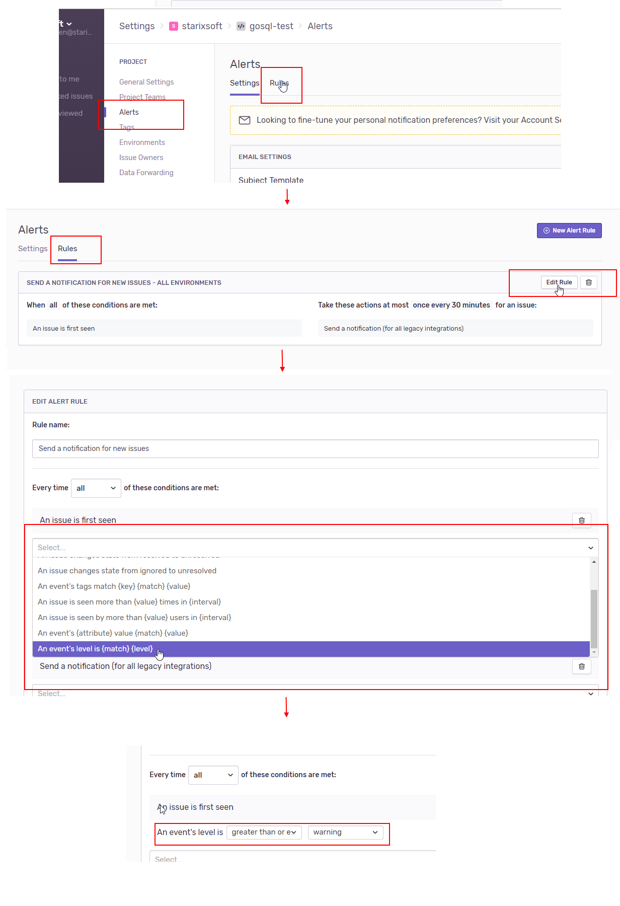

**************************
Sentry Integration
**************************

Sentry is Open-source error tracking that helps developers monitor and fix crashes in real time. Iterate continuously. Boost efficiency. Improve user experience. 
You can study more at https://docs.sentry.io/

**Step 1. Setup SentryLogging**

- Install this package 
    - For .Net Core: http://nuget.nexdev.net/packages/Fanex.Logging.Sentry 
    - For .Net Framework: http://nuget.nexdev.net/packages/Fanex.Logging.Sentry.RavenClient 
- Create new SentryLogging Instance before adding it to LogManager

.. code:: csharp

       new SentryLogging(new SentryEngineOptions
                        {
                            Dsn = new Dsn("{Your-site-sentry-token}"),
                            Release = "{Your-release-key}", // In case you want to keep track new issue for your releases
                            // You need to set FrontEndDsn in case your front-end side accesses to different Sentry endpoint with back-end side, if you dont config, Dns config above will be used for FrontEndDsn
                            FrontEndDsn = new Dsn("{Your-site-sentry-token-with-public-domain}"),
                            // If you want to log what user faces with error
                            GetUserInfo = () => new User(.net core)/SentryUser(.net framework)
                            {
                                Username = "ricky.nguyen2"
                            },
                            // Incase you need to config timeout when write log, you can config:
                            // For .net framework
                            WriteLogTimeoutSeconds = 2
                            // For .net core
                            ConfigureClient = (httpClient, dsn) =>
                            {
                               httpClient.Timeout = TimeSpan.FromSeconds(2);
                            }
                            // Be noted that default timeout is 1 second when you don't config
                        });

To config more Sentry Options you can refer to https://docs.sentry.io/error-reporting/configuration/?platform=csharp

You can get the Your-site-sentry-token in Sentry Admin site follow this image:

Example:

.. code:: csharp

       new SentryLogging(new SentryEngineOptions
                        {
                            Dsn = new Dsn("http://cedc74b2ae244da599820b107361e389@10.40.40.47:801/3"),
                            Release = "Release-2018-10-25", // In case you want to keep track new issue for your releases
                            // You need to set FrontEndDsn in case your front-end side accesses to different Sentry endpoint with back-end side, if you dont config, Dns config above will be used for FrontEndDsn
                            FrontEndDsn = new Dsn("http://cedc74b2ae244da599820b107361e389@sentry.starific.net/3"),
                            // If you want to log what user faces with error
                            GetUserInfo = () => new User(.net core)/SentryUser(.net framework)
                            {
                                Username = "ricky.nguyen2"
                            },
                            // Incase you need to config timeout when write log, you can config:
                            // For .net framework
                            WriteLogTimeoutSeconds = 2
                            // For .net core
                            ConfigureClient = (httpClient, dsn) =>
                            {
                               httpClient.Timeout = TimeSpan.FromSeconds(2);
                            }
                            // Be noted that default timeout is 1 second when you don't config
                        });

**Step 2. Change {Your-site-sentry-token} depend on your environment, this information you can config in sentry admin site**
 
+-------------+----------------------------------+-----------------------------------+-------------------------------------------+
| Environment | Sentry Admin Site (Public domain)| Dsn (Back-end) Config             | FrontEndDsn Config                        |                               
+=============+==================================+===================================+===========================================+
| LOCAL       | https://sentry.nexdev.net        | http://xxx@sentry.nexdev.net/xxx  | http://xxx@sentry.nexdev.net/xxx          |                    
+-------------+----------------------------------+-----------------------------------+-------------------------------------------+
| SIT         | http://sentry.playthefun.com     | http://xxx@172.16.4.109:800/xxx   | https://xxx@sentry.playthefun.com/xxx     |                            
+-------------+----------------------------------+-----------------------------------+-------------------------------------------+
| MNL         | http://sentry.ibcbk.com          | http://xxx@10.11.200.202:800/xxx  | http://xxx@sentry.ibcbk.com/xxx           |                               
+-------------+----------------------------------+-----------------------------------+-------------------------------------------+
| UAT - PRO   | https://sentry.starific.net      | http://xxx@10.40.40.47:801/xxx    | https://xxx@sentry.starific.net/xxx       |                       
+-------------+----------------------------------+-----------------------------------+-------------------------------------------+

*Notes:* 

- After your site started, you should write an information log to ensure your site can send log to sentry server
- You must replace xxx by your site Dsn
- When using intranet IP, please remove 's' in https because IP does not have SSL
- In order to login to above sites, please contact NexOps team to get login account
- Because of the security reason, All accounts in domain https://sentry.starific.net are required to use 2FA to login, `please follow these steps below to setup it  <sentry-otp.html>`_
- To name you project, *please do not include environment name to your project, you can use Environment filter instead*

- To select which event level will be sent through email, you can config project rule

